  

<h1 align="center">Hey, I'm Omer 👋</h1>

  

  Third-year engineering student at the National Higher Polytechnic Institute of Bamenda (NAHPI). 
  I build useful web experiences, practical tools, and cybersecurity projects while growing my skills through hands-on work.

  
  
  

  

<h2 id="featured-builds">🚀 Featured builds</h2>

  

| Project | What it does |
| --- | --- |
| [Vantage Logistics](https://github.com/TopsUchiha/vantage) | Shipment tracking, map views, and admin workflows. |
| [BBQ Smokerz](https://github.com/TopsUchiha/bbq-smokerz) | E-commerce concept with a product catalog and admin tools. |
| [Havanese Adoption & Rescue](https://github.com/TopsUchiha/Havanese) | Adoption listings with an Express and SQLite backend. |
| [MCQ Grader](https://github.com/TopsUchiha/MCQ_GRADER) · [Livestream](https://github.com/TopsUchiha/Livestream) | Practical tools and app experiments. |

<h2 id="security-journey">🛡️ Security journey</h2>

  

- ✅ Completed the **Hack The Box Linux Path**.
- 🔎 Working through the **Hack The Box Pentester Path**, currently focused on **Nmap and network reconnaissance**.
- 🌐 Studying web security with **PortSwigger Web Security Academy**.
- 🧭 Next on my roadmap: **cloud security** and **AI security**.

<h2>🧰 My toolkit</h2>

  <strong>Frontend</strong> · Next.js · React · TypeScript · JavaScript · Tailwind CSS 
  <strong>Backend &amp; data</strong> · Node.js · Express · PostgreSQL · SQLite · Prisma 
  <strong>Systems &amp; security</strong> · Linux · C · Kernel modules · Nmap · Hack The Box

  I learn by building, testing, and documenting — one project and one skill at a time.

  <a href="https://github.com/TopsUchiha">Explore my work on GitHub →</a>

